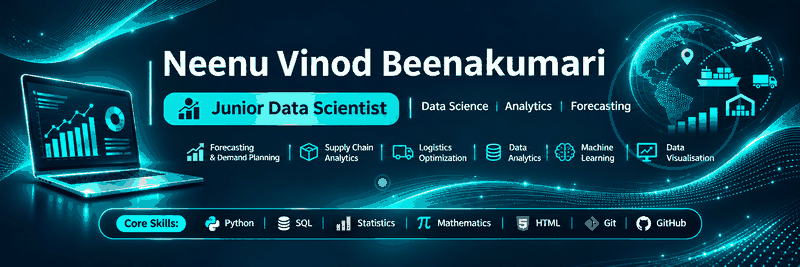
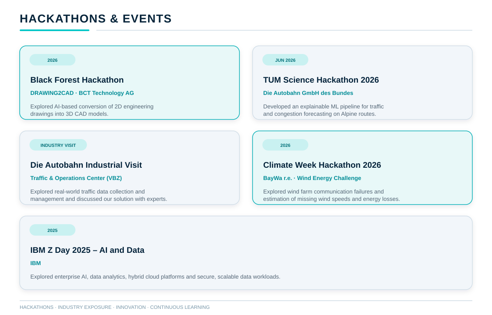
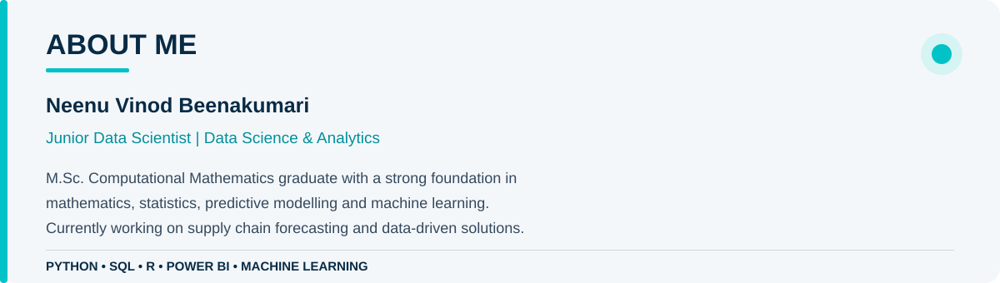
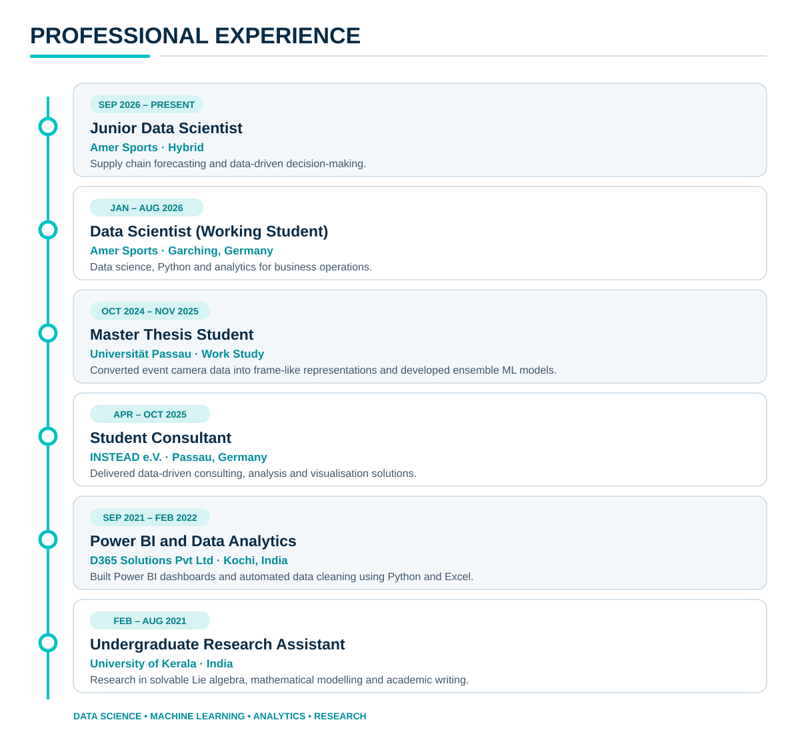
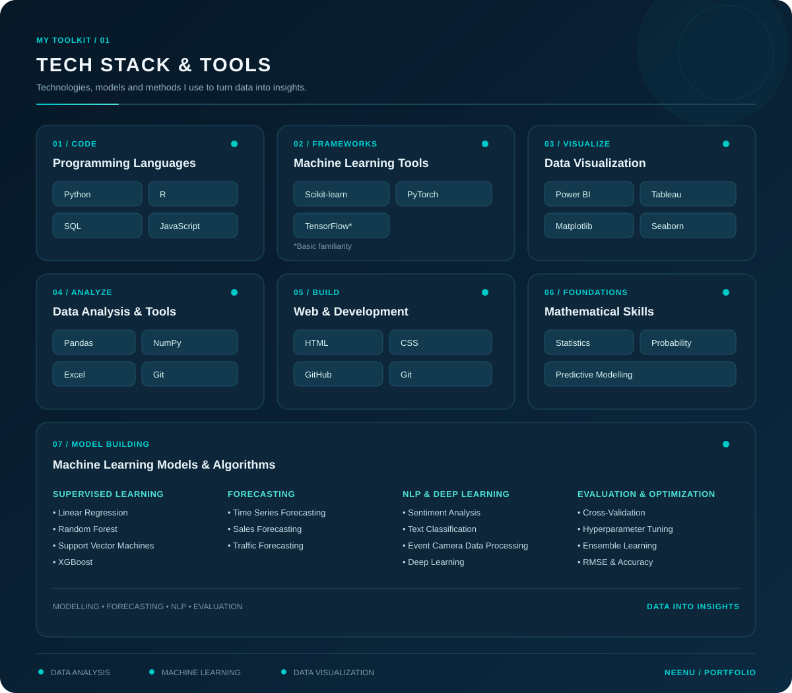

  

<h2>HACKATHONS & EVENTS</h2>

     
# 👋 Hi, I'm Neenu Vinod Beenakumari

**Junior Data Scientist | Amer Sports | Forecasting | Supply Chain Analytics**

<section id="projects">
  
</section>

  

Explore my work in data analysis, machine learning, forecasting and visualization.

